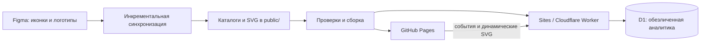
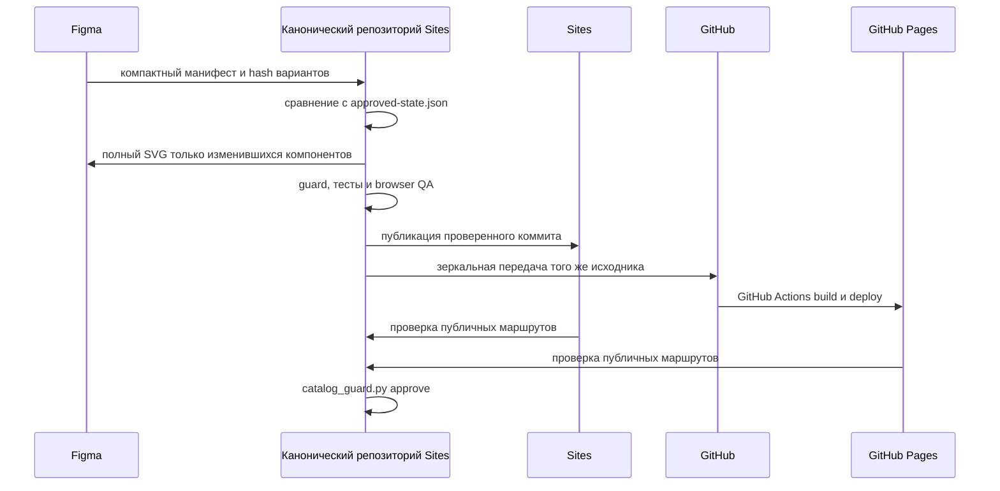

# Архитектура Directum Material Library

Документ описывает устройство каталога, источники данных, границы двух
публикаций и правила безопасного обновления. Канонический исходный код хранится
в репозитории Sites проекта `appgprj_6aad2a6856108191a51a414334e71e08`.
Репозиторий `kunivaman-dev/directum-material-library` является его зеркалом.

## Общая схема



Один исходный коммит обслуживает две площадки:

- **Sites** — полное приложение: статический каталог, динамические API,
  аналитика в D1 и приватный дашборд.
- **GitHub Pages** — статическое зеркало на домене
  `https://directum-design.desserg.ru/`. Для функций, которым нужен сервер,
  оно обращается к каноническому Sites-приложению.

## Технологический стек

- Next.js 16 и React 19;
- Vinext и Vite для сборки;
- Cloudflare Worker как серверный runtime Sites;
- Cloudflare D1 и Drizzle ORM для аналитики;
- GitHub Actions и GitHub Pages для статического зеркала;
- Node.js 22 и pnpm 11 в CI.

## Слои приложения

### Интерфейс каталога

Основной пользовательский интерфейс расположен в `public/`:

- `catalog.js` — метаданные иконок и состав вариантов;
- `assets/variants/*.svg` — варианты иконок, экспортированные из Figma;
- `icons.html`, `app.js`, `styles.css` — каталог иконок, поиск, фильтры,
  карточка, перекраска, скачивание и прямые ссылки;
- `logos-catalog.js`, `assets/logos/*.svg`, `logos.*` — каталог логотипов;
- `logobook.html` и `logobook.css` — раздел логобука;
- `analytics.js` — отправка обезличенных продуктовых событий.

Главная страница реализована в `app/page.tsx`. Она ведёт в три раздела и при
старом URL с параметрами каталога перенаправляет пользователя на `/icons`.

### Серверные маршруты

| Маршрут | Назначение | Доступность |
| --- | --- | --- |
| `/api/icon` | Возвращает SVG выбранного варианта и применяет палитру | Sites |
| `/api/events` | Принимает разрешённые продуктовые события | Sites |
| `/analytics` | Приватный дашборд владельца | Sites |
| `/`, `/icons`, `/logos` | Публичные страницы | обе площадки |

`/api/icon` принимает только известный вариант, допустимую палитру и имя файла
в формате Figma node id. Одноцветные варианты перекрашиваются отдельно от
двухцветных.

`/api/events` ограничивает размер и тип запроса, список событий и CORS двумя
публичными доменами. Сырые IP-адреса, user-agent, cookie и идентификаторы
посетителей не сохраняются. Текст запроса записывается только для нулевой
поисковой выдачи.

### Данные и аналитика

Схема D1 определена в `db/schema.ts`. Таблица `analytics_events` содержит день,
тип события, раздел, необязательные данные выбранного материала, вариант и
цвет. `db/dashboard.ts` строит агрегаты за 7, 30 и 90 дней.

Доступ к `/analytics` проверяется через ChatGPT-auth заголовки и секрет
`DASHBOARD_OWNER_EMAIL`. GitHub Pages не имеет прямого доступа к D1 и отправляет
события в Sites API.

## Источники данных

### Иконки

Правила чтения Figma хранятся в `sync/figma-sync.json`. Иконкой считается:

1. набор компонентов с явным полем `keywords:` и вариантами свойства «Вид» в
   порядке `base`, `outline`, `small`, `small-outline`, `mono`, `3d`;
2. одиночный компонент с полем `keywords:`, который не является дочерним
   элементом такого набора.

Учитываются только явные поля `category:` и `keywords:`. Свободный текст
описания не индексируется. При отсутствии категории используется
«Без категории».

### Логотипы

Метаданные логотипов находятся в `public/logos-catalog.js`, файлы — в
`public/assets/logos/`. Записи сохраняют ссылку на исходный узел Figma и
поддерживаемые варианты конкретного бренда.

### Одобренное состояние

`sync/approved-state.json` — контрольный снимок последней полностью проверенной
публикации. Он содержит владельцев, метаданные, размеры и отпечатки SVG. Этот
файл обновляется только после успешной проверки обеих публичных площадок.

## Поток синхронизации



Ключевые инварианты:

- неизменившиеся SVG не перезаписываются;
- компонент экспортируется напрямую, без фона страницы или фрейма;
- `mono` проверяется как самостоятельный вариант;
- Sites и GitHub получают один и тот же исходный код;
- частичный результат не публикуется;
- `approved-state.json` не меняется до успешной проверки обеих площадок.

## Сборка и публикация

### Sites

`vite.config.ts` собирает Worker-приложение и статические ресурсы. Привязка D1
называется `DB`; идентификатор Sites-проекта указан в `.openai/hosting.json`.

### GitHub Pages

Workflow `.github/workflows/pages.yml` запускает тесты, собирает канонический
исходник и вызывает `scripts/prepare-github-pages.mjs`. Скрипт:

- копирует клиентский build;
- создаёт статические маршруты `/icons` и `/logos`;
- добавляет `CNAME` и `.nojekyll`;
- направляет динамические SVG-ссылки на Sites API, потому что GitHub Pages не
  выполняет серверный код.

## Проверки

Перед публикацией выполняются:

```bash
node test-variants.cjs
node test-logos.cjs
node test-analytics.cjs
python3 scripts/catalog_guard.py check
```

- `test-variants.cjs` проверяет каталог иконок и SVG-варианты;
- `test-logos.cjs` проверяет каталог логотипов и их SVG;
- `test-analytics.cjs` проверяет общую точку аналитики и CORS;
- `catalog_guard.py` сравнивает рабочее состояние с одобренным снимком и
  блокирует повреждённые или неожиданные изменения.

После тестов каталог проверяется в браузере на desktop и mobile: поиск,
`mono`, прямые ссылки с вариантом и цветом, логотипы. После публикации
проверяются `/`, `/icons` и `/logos` на обоих доменах.

## Карта репозитория

```text
app/                     Next.js-страницы и серверные маршруты
db/                      схема D1 и запросы аналитики
public/                  каталоги, интерфейс и публичные SVG
scripts/                 сборка Pages, guard и вспомогательные скрипты
sync/                    правила Figma и одобренное состояние
.github/workflows/       CI/CD GitHub Pages
.openai/hosting.json     привязка к Sites-проекту
vite.config.ts           конфигурация Worker/Vite
```

## Как вносить изменения

1. Менять канонический исходник Sites, а не GitHub-зеркало.
2. Для изменений Figma соблюдать инкрементальный поток и правила из
   `sync/figma-sync.json`.
3. Запускать проверки, относящиеся к изменённому слою.
4. Сначала публиковать и проверять Sites, затем зеркалировать тот же исходник в
   GitHub и дожидаться GitHub Pages.
5. Фиксировать новое одобренное состояние только после проверки обеих
   площадок.
